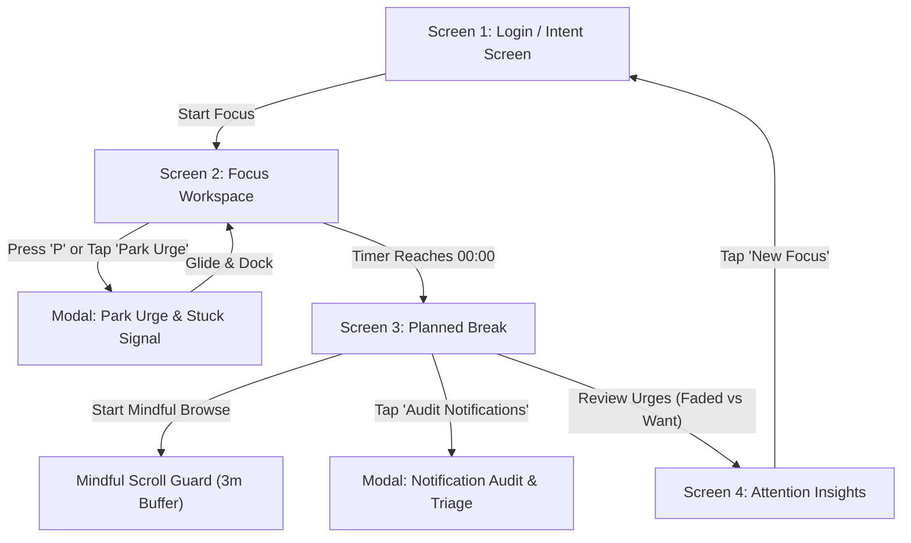

# Deliverable 2: Requirements Specification & Wireframes
**Course Project 2: Design a Digital Wellness App**  
**Project Name:** Later Lane — Focus & Urge Parking  
**Accessible Prototype Link:** [https://later-lane.vercel.app](https://later-lane.vercel.app)

---

## 1. System Requirements

### 1.1 Functional Requirements (FR)

* **FR1: Intent & Duration Configuration**
  - Users shall define a single actionable focus intent (e.g., *"Solve Calculus Problem Set 3"*).
  - Users can select duration presets (15m, 25m, 45m, 60m) or customize duration in minutes.
  - Users can categorize sessions with domain tags (*Study, Writing, Assignment, Coding, General*).

* **FR2: Single-Centerpiece Focus Workspace**
  - Displays a clean circular progress timer with an organic 4-second breathing aura ring.
  - Wall-clock synchronized countdown (`Date.now()` + `endsAt`) that never drifts or freezes when mobile devices sleep or change tabs.
  - Native Screen Wake Lock API (`navigator.wakeLock`) toggle for desk-clock mode.
  - Built-in offline Web Audio synthesizer for ambient focus sounds (*Rain, Ocean Waves, 432Hz Drone*).

* **FR3: Low-Friction Urge Parking Shelf**
  - Keyboard shortcut (`Space` to pause/resume, `P` or `U` to park) and 1-tap mobile bottom sheet.
  - Parking an impulse takes under 5 seconds: captures urge text, session minute, and timestamp.
  - Docked urges visually glide into the Later Lane tray with a gentle whoosh chime.

* **FR4: Stuck Signal Diagnostic & Empathetic Coping**
  - Identifies the root friction triggering the urge (*Confusing, Bored, Tired, Anxious, Habit*).
  - Offers immediate actionable guidance (e.g., 2-minute step splitting for confusion; 30-second guided box breathing for anxiety).

* **FR5: Planned Break & Urge Expiry Review (The "Aha!" Moment)**
  - Automatically transitions to a 5-minute rest timer with singing bowl auditory cues.
  - Presents each parked urge for 1-tap evaluation (*"Faded away"* vs. *"Still want to do"*).
  - Quantifies saved distraction time (e.g., *"3 of 4 urges faded on their own — saved ~30 minutes"*).

* **FR6: Mindful Break Scroll Guard (Digital Wellness Buffer)**
  - Provides a 2m, 3m, or 5m countdown buffer for students who choose to check their phone during the break.
  - Soft double-bell audio reminder when the buffer ends, preventing break doomscrolling.

* **FR7: Notification Audit & Distraction Triage**
  - Categorizes notification channels into 3 tiers: **VIP (Real-Time)**, **Break-Only (Batch)**, and **Silent / DND (Off)**.
  - Provides step-by-step guidance for Android Do Not Disturb and iPhone Focus modes.
  - Calculates estimated study interruptions prevented.

* **FR8: Non-Shaming Attention Insights Dashboard**
  - Visualizes an **Attention Waveform** histogram showing exactly which minutes impulses cluster.
  - Summarizes urge fade rates, stuck signal distributions, and longitudinal focus minutes.
  - Zero guilt scores, zero red strike warnings, and zero punitive streaks.

* **FR9: Cross-Device Cloud Sync & Authentication**
  - Supabase Auth integration via Google OAuth (PKCE flow).
  - PostgreSQL Row Level Security (RLS) guaranteeing private, isolated data storage per user.
  - Offline-first caching with automatic sync upon reconnection.

---

### 1.2 Non-Functional Requirements (NFR)

* **NFR1: Performance & Offline Resilience:** First contentful paint under 1.2s; 100% offline functionality via PWA Service Worker (`Cache-First` / `Network-First` strategy).
* **NFR2: Mobile Technical Integrity:** Timers must maintain sub-second accuracy across phone lock, backgrounding, and tab suspension without consuming excessive battery.
* **NFR3: Emotional Ergonomics:** Visual design must adhere to the Serene Sanctuary system (Midnight dark `#07090F`, Morning Mist light `#F3F5F8`, soft teal/indigo aura `#2DD4BF`, `#818CF8`).
* **NFR4: Accessibility:** Adheres to WCAG AA contrast standards, keyboard navigability (Esc, Enter, Space, numbers 1–5), and native `prefers-reduced-motion` compliance.
* **NFR5: Privacy & Security:** Client-side local data storage with zero third-party behavioral trackers or advertising analytics.

---

## 2. Hand-Drawn & Structural Wireframes

### Screen Flow & State Architecture



---

### Text & ASCII Structural Layouts

#### Screen 1: Set Intent (Launch Canvas)
```text
+-------------------------------------------------------------+
| Later Lane (Opal Orb)                      Light/Dark Theme |
+-------------------------------------------------------------+
|                                                             |
|                 What is your focus intent?                  |
|          Give your mind a clear destination for now.        |
|                                                             |
|    +---------------------------------------------------+    |
|    | [ e.g. Read Biology Chapter 4: Cell Division    ] |    |
|    +---------------------------------------------------+    |
|                                                             |
|    Tags: [ (Study) ] [ Writing ] [ Assignment ] [ Coding ]  |
|                                                             |
|    Duration: [ 15m ] [ (25m) ] [ 45m ] [ 60m ] [ Custom: 25]|
|                                                             |
|                  [ Begin Focus Session -> ]                 |
|                                                             |
+-------------------------------------------------------------+
```

#### Screen 2: Focus Session & Urge Parking Shelf
```text
+-------------------------------------------------------------+
| Later Lane                             Signed in as: Nikhil |
+-------------------------------------------------------------+
|                    "Read Biology Chapter 4"                 |
|                            [ Study ]                        |
|                                                             |
|                          . - ~ - .                          |
|                      . '           ' .                      |
|                    /     24:18         \   (Gentle Breathing|
|                   |   Remaining         |   Teal/Indigo Orb)|
|                    \                   /                    |
|                      . '           ' .                      |
|                          ' - ~ - '                          |
|                                                             |
|             [ Pause / Resume ]   [ + Park an Urge ]         |
|                                                             |
|    - - - - - - - - - Later Lane Shelf - - - - - - - - - -   |
|    | * Check Instagram reel          Minute 12 · Bored     | |
|    | * Mitosis diagram meme          Minute 17 · Confusing | |
|    - - - - - - - - - - - - - - - - - - - - - - - - - - - -   |
+-------------------------------------------------------------+
```

#### Screen 3: Planned Break & Mindful Scroll Guard
```text
+-------------------------------------------------------------+
|                  Session complete. Breathe easy.            |
|                     Completed 25m of Focus                  |
|                                                             |
|    +---------------------------------------------------+    |
|    |  Rest Timer:   04:32            [ Pause ] [ +5m ] |    |
|    +---------------------------------------------------+    |
|                                                             |
|    +-- Mindful Scroll Guard ---------------------------+    |
|    |  Checking phone? Set a boundary before opening:   |    |
|    |  Duration: [ 2m ] [ (3m) ] [ 5m ]                 |    |
|    |  [ Start Mindful Browse Window ]                  |    |
|    +---------------------------------------------------+    |
|                                                             |
|    Urge Expiry Review:                                      |
|    +---------------------------------------------------+    |
|    | * "Check Instagram reel" (Min 12 · Bored)         |    |
|    |   [ (Faded Away) ]        [ Still Want to Do ]    |    |
|    +---------------------------------------------------+    |
|    | * "Mitosis diagram meme" (Min 17 · Confusing)     |    |
|    |   [ (Faded Away) ]        [ Still Want to Do ]    |    |
|    +---------------------------------------------------+    |
|                                                             |
|             [ Complete & View Insights Dashboard ]          |
+-------------------------------------------------------------+
```

#### Screen 4: Non-Shaming Attention Insights Dashboard
```text
+-------------------------------------------------------------+
| Attention Insights                      [ 7 Days ] [ All ]  |
| Where your attention shifts — gentle patterns across time.  |
|                                                             |
|  [ Sessions: 12 ] [ Focus: 320m ] [ Parked: 28 ] [ Fade: 78% ]
|                                                             |
|  Attention Waveform (Minutes when urges typically surface)  |
|    |                                                        |
|    |             _||_                                       |
|    |       _||_  ||||  _||_                                 |
|    |___||__||||__||||__||||__||________________             |
|        0-5 6-10 11-15 16-20 21-25 26-30 31m+                |
|                                                             |
|  Notification Audit & Triage                                |
|  [ 1 VIP Contact ] [ 3 Batch to Break ] [ 2 Silenced DND ]  |
|  [ Configure Alert Rules & Step-by-Step Phone Guide -> ]    |
|                                                             |
|  [ + Start Next Focus Session ]                             |
+-------------------------------------------------------------+
```
